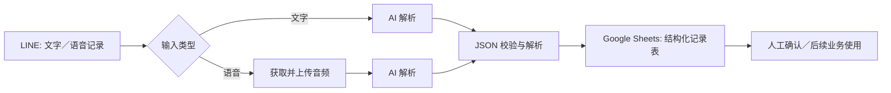
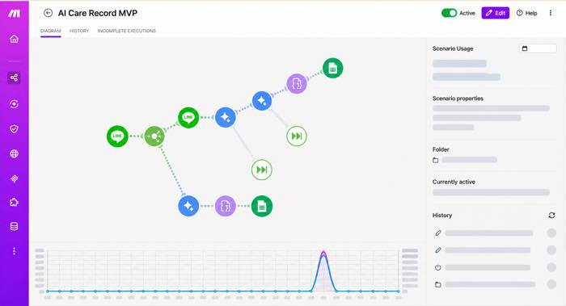
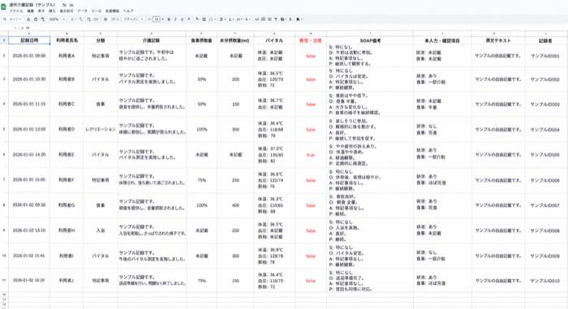

# AI 介护现场记录自动化 MVP

> 将 LINE 中的文字或语音现场记录，转换为结构化、可人工核对的日语介护记录，并写入记录表。

[日本語](#日本語)

## 项目背景

通所介护现场的记录往往分散在文字、语音和口语沟通中。对于非母语员工而言，如何将中日混合表达转换为规范的日语介护用语，也会增加记录与交接的负担。

本项目是一个面向日本通所介护场景的自动化 MVP。它验证了 AI 能否协助完成记录整理，同时保留原始内容、待确认项和人工审核空间，便于追溯与安全使用。

## 核心能力

- 从 LINE 接收文字或语音记录
- 自动区分文字与语音两种输入路径
- 使用 AI 理解中日混合的现场描述，并规范为日语介护专业表达
- 输出固定 JSON 数据结构，提取利用者姓名、分类、食事／水分摄取、バイタル、异常项、SOAP 与待确认项
- 将结果写入 Google Sheets，形成便于查看和追溯的结构化记录
- 在文件上传和 AI 处理节点设置不中断主流程的错误处理

## 流程架构

## MVP 画面展示

### Make 自动化流程

文字与语音记录会分流处理，经 AI 解析和 JSON 校验后写入 Google Sheets，并保留人工确认环节。

### Google Sheets 结构化记录示例

示例使用脱敏测试数据，仅展示记录字段与呈现方式。

## 结构化输出

AI 输出并解析以下主要字段：

| 字段 | 用途 |
| --- | --- |
| `patient_name` | 利用者姓名（统一使用「姓氏 + 様」） |
| `category` | 食事、排泄、入浴、バイタル、服薬、特記事项等分类 |
| `care_record_ja` | 规范化的日语介护记录 |
| `detail` | 食事摄取量、水分摄取量、生命体征 |
| `is_abnormal` | 异常／注意标记 |
| `soap_text` | SOAP 格式记录 |
| `missing_info` | 需要人工补充或核实的信息 |
| `raw_transcript` | 原始输入内容，用于追溯 |

## 我的工作

- 从一线介护记录、交接信息碎片化和多语言表达不统一的问题出发，定义 MVP 的使用场景与数据字段。
- 设计文字／语音双路径自动化流程，并通过 Make 集成 LINE、Gemini 与 Google Sheets。
- 编写提示词与 JSON Schema，将口语化表达转换为日语介护专业用语，同时提取结构化信息。
- 在设计中加入原文留存、缺失字段提示、异常标记和人工确认等可追溯性与风险控制考虑。

## 技术栈

- Make（场景编排与自动化）
- LINE Messaging API
- Google Gemini API
- Google Sheets
- JSON Schema / 结构化提示词

## 查看蓝图

公开展示用的脱敏 Make 蓝图位于：

- [`Integration_LINE_public_portfolio.blueprint.json`](./Integration_LINE_public_portfolio.blueprint.json)

该文件保留场景结构和字段映射，但已移除生产环境的连接标识、Webhook、机构名称、账号和表格标识。导入后需要自行配置连接与目标表格，不能直接用于生产环境。

## 隐私与使用边界

- 本仓库不包含任何真实利用者资料、生产连接配置或真实机构数据。
- AI 生成的内容是**记录草稿**，不能替代介护专业人员的判断、确认或正式记录责任。
- 正式使用时应根据机构制度处理访问控制、日志审计、数据保存期限、个人信息保护和异常处置。

## 下一步

- 设计人工确认界面与异常提醒机制
- 为不同介护场景补充更多结构化字段与样例
- 以匿名测试数据评估记录完整性、术语准确性和人工修订率
- 从 Google Sheets 原型逐步升级为具备权限和审计能力的系统

---

## 日本語

### 概要

LINEで送信されたテキストまたは音声の現場記録を、確認可能な構造化介護記録へ変換し、記録表へ登録する通所介護向けのAI活用MVPです。

### 主な機能

- LINEからテキスト／音声記録を受信
- 入力形式ごとのルーティング
- 中日混在の口語表現を、介護専門用語を用いた日本語記録へ整形
- 利用者名、分類、食事・水分摂取量、バイタル、注意事項、SOAP、確認事項をJSONで抽出
- Google Sheetsへの構造化記録の登録
- 原文保持と確認事項の出力による追跡可能性の確保

### 重要な前提

本プロジェクトは業務記録の下書きを支援するMVPです。AIの出力は必ず担当者が確認し、専門的な判断や正式な記録責任を代替するものではありません。

公開版のブループリントには、本番接続情報、事業所名、アカウント情報、実在の利用者情報は含まれていません。
